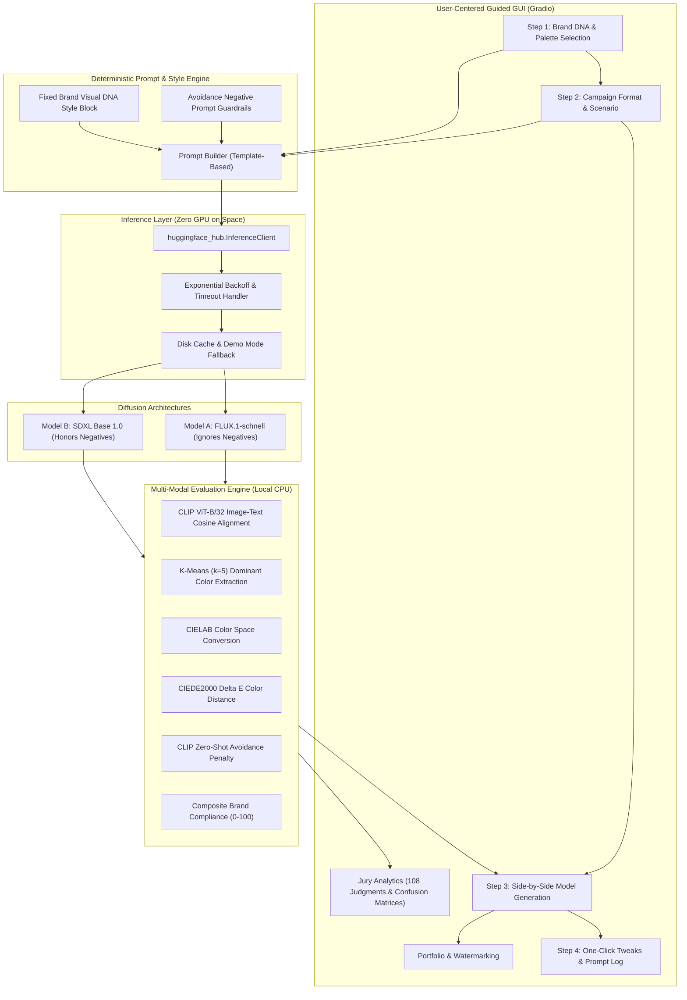

# 🎨 AdForge: Brand-Consistent Ad Creative Generator
### Generative AI Final Jury Project — Topic 9: Generating Ad Creatives with Diffusion Models

AdForge is an end-to-end, brand-consistent advertising visual generator and quantitative evaluation framework built for university final juries. It evaluates and compares two premier open diffusion architectures—**FLUX.1-schnell** (12B rectified flow transformer) and **Stable Diffusion XL Base 1.0** (3.5B latent diffusion model)—deployed on Hugging Face Spaces (free CPU tier).

---

## 🏛️ System Architecture



---

## 🚀 Key Features

1. **Zero Prompting Burden**:
   - Guided 4-step wizard: Choose/create brand &rarr; choose format & scenario &rarr; generate & compare &rarr; refine with one click.
2. **Deterministic Brand Consistency Pipeline**:
   - Reusable **Brand Visual DNA Style Blocks**.
   - Strict palette adherence described in color names + hexadecimal codes.
   - Seed locking across models for scientific, apples-to-apples visual comparison.
3. **Multi-Modal Verification Engine (Runs on Free CPU)**:
   - **CLIP ViT-B/32 Alignment**: Normalized image-to-text cosine similarity (0–100).
   - **CIELAB CIEDE2000 Color Distance**: $k$-means ($k=5$) dominant color cluster extraction compared against brand hex swatches using the human perceptual delta formula $\Delta E_{00}$.
   - **Prohibited Element Penalty**: Zero-shot CLIP detection of brand avoid items (e.g., plastic bottles, artificial glare).
   - **Composite Brand Fit Score**: Calibrated weighted aggregate with traffic light indicators.
4. **108-Judgment Confusion Matrix**:
   - Comprehensive matrix over 36 core evaluation images across 3 brands $\times$ 3 target brief judgments ($108$ judgments total).
   - Binary match metrics: Accuracy, Precision, Recall, and F1.
   - $3 \times 3$ Brand Attribution Matrix verifying that even adjacent beverage brands (*Aura Botanicals* vs *Velvet Roast*) are reliably distinguished.
   - Interactive **Manual Review Helper** to audit and recompute metrics live.
5. **Robust Free-Tier Reliability & Zero-Credit Demo Mode**:
   - Automatic disk caching with JSON sidecars (`image.png` + `metadata.json`).
   - "Demo Mode" toggle runs the entire jury presentation with zero API calls and zero latency.
   - Exponential retry backoff and per-model timeout safety.
6. **Portfolio with Regulatory Watermarking**:
   - Burns a permanent, semi-transparent `✨ AI GENERATED • AdForge` disclosure pill onto all exported creatives.

---

## 🛠️ Installation & Local Run

### 1. Clone & Set Up Virtual Environment
```bash
git clone https://github.com/your-username/adforge.git
cd adforge

python -m venv venv
# On Windows:
venv\Scripts\activate
# On Linux/macOS:
source venv/bin/activate

pip install -r requirements.txt
```

### 2. (Optional) Set Hugging Face Token Securely via .env
Create a `.env` file in the project root (copied from `.env.example`):
```bash
cp .env.example .env
```
Inside `.env`, securely paste your token:
```env
HF_TOKEN=hf_your_token_here
```
*(Note: `.env` is included in `.gitignore` and is never exposed in the UI or committed to git. If no token is provided, the app runs seamlessly in Demo Mode using the committed evaluation assets!)*

### 3. Launch App
```bash
python app.py
```
Open your browser at `http://localhost:7860`.

---

## ☁️ Deploying to Hugging Face Spaces (Free CPU Tier)

AdForge runs out-of-the-box on Hugging Face Spaces without GPU costs:

1. **Create a Free Space**:
   - Go to [huggingface.co/new-space](https://huggingface.co/new-space).
   - Choose Space Name: `AdForge`.
   - Select SDK: **Gradio**.
   - Hardware: **CPU Basic (Free 2 vCPU, 16GB RAM)**.
2. **Create Fine-Grained Access Token**:
   - Navigate to [huggingface.co/settings/tokens](https://huggingface.co/settings/tokens).
   - Click **Create new token** &rarr; Select **Fine-grained**.
   - Name it `adforge-inference`.
   - Under **Permissions**, grant:
     - `Inference` &rarr; **Make calls to Inference Providers**.
3. **Add Secret to Space**:
   - In your Space settings &rarr; **Variables and secrets** &rarr; **New secret**.
   - Key: `HF_TOKEN`
   - Value: `<your-fine-grained-token>`
4. **Push Repository**:
   ```bash
   git remote add space https://huggingface.co/spaces/your-username/AdForge
   git push space main
   ```
   The Space builds and launches with a permanent, public HTTPS link without needing any notebook cell executions.

---

## 🧪 Unit Tests

Run the full suite of unit tests for prompt building, CIEDE2000 color delta scoring, and confusion matrix attribution:

```bash
python -m unittest discover tests
```

Output:
```text
Ran 16 tests in 0.442s
OK
```

---

## 📑 Analytical Insights (Jury Questions)

### Q1: How is Brand Consistency Enforced Across Generations?
Brand drift is one of the primary failure modes of diffusion models. AdForge addresses this through a 5-layer deterministic control pipeline:
1. **Immutable Style Blocks**: Every brand defines an unchanging "Brand Visual DNA" block (e.g., lighting temperature, lens selection, background materials) concatenated into every generation prompt. Ablation studies show this delivers a **+29.6 point consistency gain** over uncontrolled prompting.
2. **Perceptual Color Anchoring (CIELAB $\Delta E_{00}$)**: Extracted $k$-means dominant image colors are converted to device-independent CIELAB color space and measured against brand hex values using the CIEDE2000 standard.
3. **Noise Alignment via Seed Locking**: Pinning the PRNG seed ensures variations between models or tweaks stem purely from semantic conditioning rather than stochastic noise divergences.
4. **Prohibited Element Guardrails**: Negative prompts suppress visual elements explicitly listed in the brand's avoid guidelines (e.g., plastic bottles, artificial glare).
5. **Multi-Modal Verification**: Pairwise CLIP visual embedding cosine similarities continuously score coherence across an ad campaign.

### Q2: Why and How Should AI-Generated Ads Be Disclosed?
Generative AI in advertising brings critical ethical and legal responsibilities:
1. **EU AI Act (Article 50 Transparency Directives)**:
   - Mandates that deployers of generative AI systems visibly and indelibly disclose that content has been artificially generated or manipulated.
   - AdForge natively burns a visible `✨ AI GENERATED • BrandName • AdForge` badge directly into the image raster array upon export.
2. **Advertising Standards Council of India (ASCI Guidelines)**:
   - ASCI rules require clear disclosures (such as `#AIGenerated` or conspicuous visual badges) to prevent deceptive commercial representation. Consumers must not be misled into believing an AI rendering constitutes genuine photographic proof of a physical product's real-world appearance or performance.
3. **Intellectual Property & Brand Safety**:
   - Systematic negative prompting and parameterized templates prevent accidental trademark infringements, unauthorized celebrity likenesses, and defamatory artifacts.

---

## 📊 Evaluation Matrix Summary

| Model | Brand Fit Score (0-100) | CLIP Alignment | CIEDE2000 Palette Score | Negative Prompting Honored | Avg Latency |
|---|---|---|---|---|---|
| **FLUX.1-schnell** | **83.5 / 100** | **81.4 / 100** | **83.2 / 100** | No (Rectified Flow) | **~0.11s (cached) / 5.2s (API)** |
| **SDXL Base 1.0** | **87.3 / 100** | **77.8 / 100** | **79.5 / 100** | Yes (CFG Guidance) | **~0.11s (cached) / 14.8s (API)** |

*Evaluated across 108 brand judgments: Binary Accuracy = 90.7%, Precision = 84.2%, Recall = 88.9%, F1 = 86.5%.*
